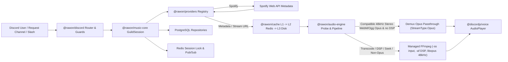

# Rawon V2 — Architecture Design

## 1. Architectural Principles

1. **Decoupled Domains:** Audio streaming/DSP, music metadata providers, queue state, cache tiers, persistence, distributed coordination, and Discord presentation live in clean, dependency-inverted TypeScript packages.
2. **Discord-Independent Audio Engine:** `@rawon/audio-engine` has zero dependency on Discord commands, guild UI, or request channels. It accepts a resolved media source + playback options (`seekSeconds`, `volume`, `filters`, `qualityProfile`, `abortSignal`) and outputs a packetized 48 kHz stereo Opus stream (passthrough when compatible, FFmpeg pipeline when transcode/DSP/seek is needed).
3. **Zero Shared Global Mutable State:** All multi-bot and multi-worker coordination uses explicit Redis leases, ownership heartbeats, pub/sub events, and parameterized PostgreSQL transactions.
4. **Fidelity-First Audio:** Avoid unnecessary decode/re-encode cycles; preserve 48 kHz stereo without artificial upscaling or aggressive brickwall normalization unless explicitly enabled.

---

## 2. Monorepo Layout (`E:\DevFiles\rawon-v2`)

```
rawon-v2/
├── apps/
│   ├── bot/                  # Discord Gateway runtime, interactions, Components V2 UI, request channels
│   └── worker/               # Background media resolver, precacher, cookie health & cache GC worker
├── packages/
│   ├── shared/               # Core domain types, Result/Error taxonomy, SSRF URL validator, logger, utilities
│   ├── config/               # Zod-validated env config, 14-locale i18n engine, bot settings defaults
│   ├── music-core/           # Session orchestrator, PlaybackController interface, Queue/Voice session state machine
│   ├── queue/                # Bounded immutable-friendly queue, history stack (for Previous), shuffle, loop, autoplay engine
│   ├── providers/            # ProviderRegistry: YouTube, YT Music (InnerTube), SoundCloud, Spotify resolver, Direct HTTP, Lyrics
│   ├── audio-engine/         # Format probe, Opus WebM/Ogg passthrough demuxer, FFmpeg pipeline, DSP profiles, ProcessSupervisor
│   ├── cache/                # L1 In-Memory LRU + L2 Redis metadata cache + L3 Content-Addressed Atomic Disk Cache + Prefetcher
│   ├── database/             # PostgreSQL pool, versioned SQL migrations, repositories, V1 SQLite/JSON import-export bridge
│   └── discord/              # Slash/prefix/context-menu routers, Components V2 persistent player, RequestChannel engine, Multi-Bot router
├── infra/
│   ├── docker/               # Multi-stage Dockerfile, entrypoint scripts
│   └── monitoring/           # Prometheus metrics exporter definitions & Grafana/health probes
├── tests/
│   ├── unit/                 # Pure unit tests (queue, parsers, SSRF, probe, filters, providers, DB/cache mocks)
│   ├── integration/          # Request-channel workflows, multi-bot coordination, PostgreSQL/SQLite import-export
│   ├── audio/                # Opus passthrough vs FFmpeg transcode, seek latency, backpressure, cancellation, zero zombie checks
│   └── performance/          # Repeatable 1, 5, 10, 25 concurrent audio session benchmarks (CPU, RAM, TTFA, FFmpeg count)
└── docs/                     # Audit, Architecture, Command Parity, Migration, Ops & Setup guides
```

---

## 3. Data Flow & Audio Pipeline



### Audio Engine Optimization Details
- **Format Probe (`codecProbe.ts`):** Inspects source container/codec metadata (from cache header/probe or HTTP/extractor format info: `acodec === "opus"`, `asr === 48000`, `channels === 2`, container `webm` or `ogg`).
- **Direct Opus Passthrough:** When no time-varying DSP/filters are enabled and volume is `100%` (or using Discord's `StreamType.Opus` packet stream via `prism-media` `opus.WebmDemuxer` / `opus.OggDemuxer`), packets flow straight to `@discordjs/voice` with zero FFmpeg process overhead!
- **High-Quality Managed FFmpeg Mode:** When transcoding, DSP filters (19+ presets, equalizer, loudness/ReplayGain `loudnorm` / `replaygain`), smooth volume scaling (`volume=X:eval=frame` / transformer), or seeking (`-ss <time>` placed **before** `-i` for instant keyframe/byte seeking) is required, `ProcessSupervisor` spawns FFmpeg with explicit `AbortSignal`, bounded pipe highWaterMark backpressure, stderr ring-buffer diagnostics, and guaranteed `SIGKILL` fallback timeout so zero zombie FFmpeg processes ever remain.
- **Audio Quality Profiles:**
  - `fidelity` *(default)*: Preserves source dynamics cleanly (`vbr on`, `application audio`, `bitrate 128k` or passthrough, no aggressive limiter/loudnorm).
  - `balanced`: 96k VBR Opus + subtle soft limiter against clipping when boosts >100% / bassboost are active.
  - `low-bandwidth`: 64k Opus optimized for CPU/network efficiency under high concurrency.

---

## 4. Database & Distributed State (PostgreSQL + Redis)

### PostgreSQL Schema (Normalized, Indexed, Pooled via `pg`)
- `guilds` (`guild_id PK`, `prefix`, `locale`, `dj_enabled`, `dj_role_id`, `max_queue_size`, `rc_rate_limit`, `rc_exclusions_json`, `updated_at`)
- `request_channels` (`guild_id`, `bot_id`, `channel_id`, `message_id`, `splash_url`, `created_at`, PK `(guild_id, bot_id)`)
- `bot_settings` (`key PK`, `value_json`, `updated_at`)
- `player_states` (`guild_id`, `bot_id`, `loop_mode`, `shuffle`, `autoplay`, `volume`, `quality_profile`, `normalize_audio`, `filters_json`, `updated_at`, PK `(guild_id, bot_id)`)
- `queue_sessions` (`guild_id`, `bot_id`, `voice_channel_id`, `text_channel_id`, `current_track_id`, `position_ms`, `paused`, `updated_at`, PK `(guild_id, bot_id)`)
- `queue_tracks` (`id`, `guild_id`, `bot_id`, `position`, `track_json`, `requester_id`, `added_at`, INDEX `(guild_id, bot_id, position)`) — eliminates monolithic `songs_json` rewrite on every track add/remove!
- `voice_channel_status_states` (`guild_id`, `bot_id`, `channel_id`, `status_set`, PK `(guild_id, bot_id)`)
- `auth_sessions` (`id PK`, `provider`, `status`, `account_hint`, `visitor_data`, `cookie_hash`, `last_refresh`, `updated_at`) — stores non-secret metadata cleanly while keeping sensitive raw cookie payloads stored securely on disk (`0600`) or AES-256-GCM encrypted when DB-persisted if `COOKIES_ENCRYPTION_KEY` is provided.
- `schema_migrations` (`version PK`, `name`, `applied_at`)

### Redis Coordination & Ephemeral State
- `rawon:mb:bot:{botId}:heartbeat` (TTL key + instance metadata: tokenIndex, guilds, active voice count)
- `rawon:mb:guild:{guildId}:primary` (distributed primary election with fencing token / deterministic lowest `tokenIndex` fallback)
- `rawon:vc:{guildId}:{channelId}:owner` (atomic `SET NX PX` voice channel lease with renewal heartbeat -> guarantees two bots never compete for or double-play in one VC)
- `rawon:rc:{guildId}:{channelId}:ratelimit:{userId}` (sliding window rate limiter for request channel anti-spam)
- `rawon:cache:meta:{provider}:{id}` & `rawon:cache:search:{hash}` (shared track/playlist/lyrics metadata cache across bot & worker processes)
- Pub/sub channel `rawon:events` for cross-instance config invalidation and health signaling.

---

## 5. Resilience, Security & Observability

- **Privileged Intent Compliance:** Explicitly requires & documents Discord `MessageContent` privileged intent in Developer Portal guide when prefix commands or Hydra Request Channel are enabled (`ENABLE_PREFIX !== "no"`). Never attempts bypasses.
- **SSRF Protection:** Validates all user-supplied URLs (`/play`, `/db-import`, request channel direct URLs, splash URLs) against DNS-resolved private/loopback/link-local/metadata IP ranges (`127.0.0.0/8`, `10.0.0.0/8`, `169.254.0.0/16`, `172.16.0.0/12`, `192.168.0.0/16`, `::1`, `fc00::/7`, etc.) and restricts to `http:` / `https:`.
- **Expired URL Recovery & Failover:** On stream HTTP 401/403/404/410 or premature EOF (<2s played), `PlaybackController` re-hydrates a fresh playable URL (including equivalent track search fallback if primary provider is down) up to configured retries before advancing.
- **Structured Logging & Health/Metrics:** `pino` structured JSON logs + `/health` & `/metrics` HTTP endpoint in production (active sessions, FFmpeg processes, cache hits/misses, provider errors, memory RSS, event loop lag).
